# One UI

**A UI to rule them all.**

One UI gives every app the same cards, buttons, colours and dark mode, so moving between them feels like using one product.

### ▶ [Open the live demo](https://auxxxilium.github.io/one-ui/demo/)

The demo shows every element filled with made-up sample content. Use the sun/moon button in the top right to try light and dark, the five colours and the glass look. There is also a [plain HTML version](https://auxxxilium.github.io/one-ui/demo/plain.html).

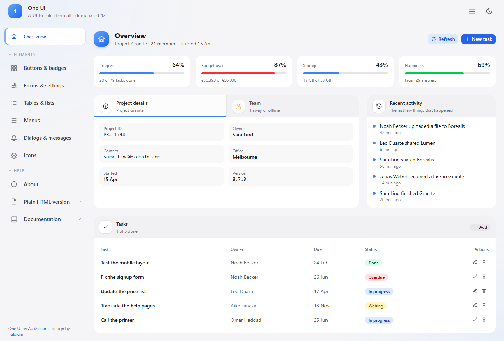

---

## Credits: required

One UI is **developed by [AuxXxilium](https://auxxxilium.tech)**, with **theme and design by [Fulcrum](https://github.com/FulcrumCode)**.

> **If you use One UI, all of it or any part, you must name both AuxXxilium and Fulcrum** somewhere your users can see it, such as an About page, a footer or the sidebar. Removing or hiding the credit is not allowed. See [NOTICE](NOTICE).

You don't have to write the credit yourself:

- The ready-made layout (`AppShell`) already shows it at the bottom of the sidebar.
- `<Credits />` draws the credit block, e.g. on your About page (see [Credits](#credits)).
- In plain HTML, copy the `oui-credits` line from [Plain HTML](#plain-html-no-build-step).

---

## Contents

- [What it looks like](#what-it-looks-like)
- [Two ways to use it](#two-ways-to-use-it)
- [Light, dark, colour and glass](#light-dark-colour-and-glass)
- [App icons](#app-icons)
- [The elements](#the-elements)
- [Plain HTML (no build step)](#plain-html-no-build-step)
- [What is in this folder](#what-is-in-this-folder)
- [Changing the demo and the pictures](#changing-the-demo-and-the-pictures)

---

## What it looks like

| Light | Dark |
|---|---|
|  | 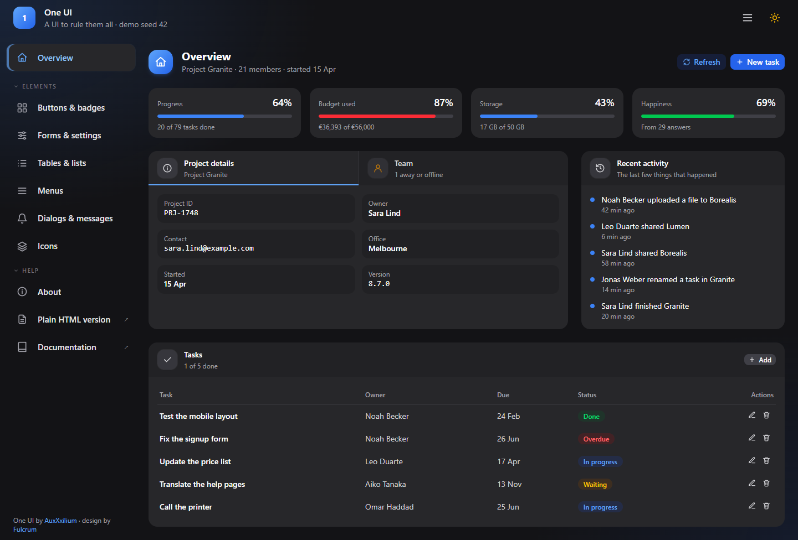 |
| **Glass, light** | **Glass, dark, amber** |
| 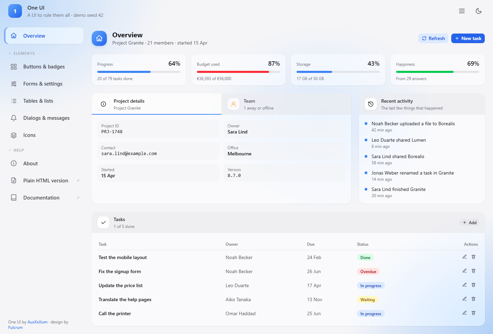 | 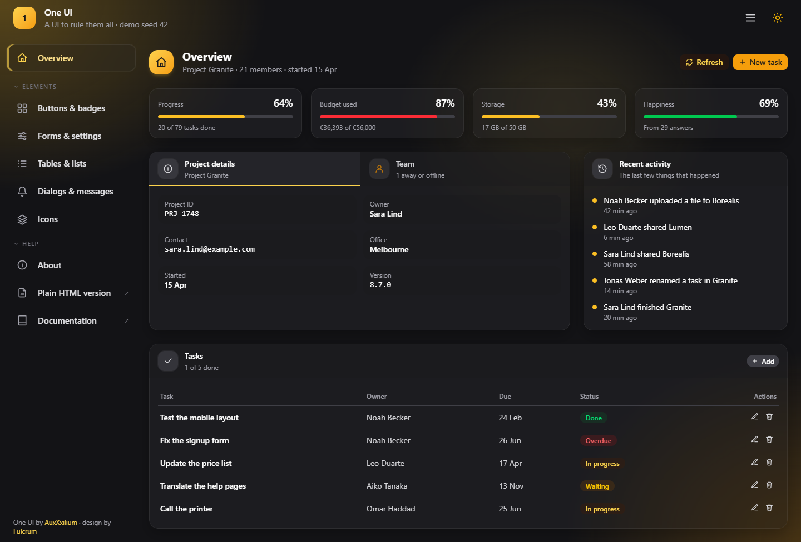 |

It also works on a phone: the sidebar folds away behind the ☰ button, and wide tables scroll sideways inside their card.

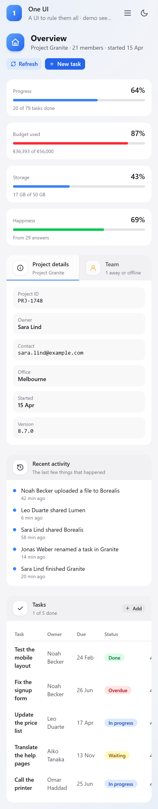

---

## Two ways to use it

| You are building… | Use | You get |
|---|---|---|
| An app with **Preact and Tailwind** | the **preset** in `src/` | Ready-made components: `<Card>`, `<Button>`, `<Modal>` … |
| A **plain web page** with no build step | the **plain version** in `plain/` | One CSS file and one small script. You write normal HTML with `oui-` classes. |

Both look the same and remember the same settings, so a plain page opened next to an app changes colour with it.

### Preact + Tailwind

**1. Add One UI to your stylesheet**, after Tailwind:

```css
@import 'tailwindcss' source(none);
@source '.';
@import '../node_modules/one-ui/src/one-ui.css';
```

One UI tells Tailwind where its own components are, so you don't need to add anything else.

**2. Build your app with the layout and a few pieces:**

```jsx
import { h } from 'preact';
import { useState } from 'preact/hooks';
import { AppShell, PageHeader, Card, Button, useTheme } from 'one-ui';

const NAV = [
  { id: 'home',     label: 'Overview', icon: 'main' },
  { id: 'tasks',    label: 'Tasks',    icon: 'list',     section: 'Work' },
  { id: 'settings', label: 'Settings', icon: 'settings', section: 'Account' },
];

export default function App() {
  const theme = useTheme();                 // light/dark, colour and glass, remembered
  const [page, setPage] = useState('home');

  return (
    <AppShell title="My App" subtitle="Hello there" logo="logo.png"
              theme={theme} nav={NAV} active={page} onSelect={setPage}>
      <PageHeader icon="main" title="Overview" subtitle="Everything at a glance">
        <Button icon="refresh" variant="outline">Refresh</Button>
      </PageHeader>
      <Card title="Welcome" icon="info">Your content goes here.</Card>
    </AppShell>
  );
}
```

That is a complete app: title bar, sidebar, appearance menu, credit line and a page.

> One UI needs `preact` (10.19 or newer) and `tailwindcss` (4.1 or newer). Each file imports `h`, so it works with both ways of building Preact JSX (`pragma: 'h'` and the automatic runtime).

### Plain HTML

```html
<link rel="stylesheet" href="one-ui-plain.css">
<script src="one-ui-plain.js"></script>
```

Then write ordinary HTML with the classes listed under [Plain HTML](#plain-html-no-build-step).

---

## Light, dark, colour and glass

The sun/moon button opens the **appearance menu**. It has three settings, and each one is remembered in the browser.

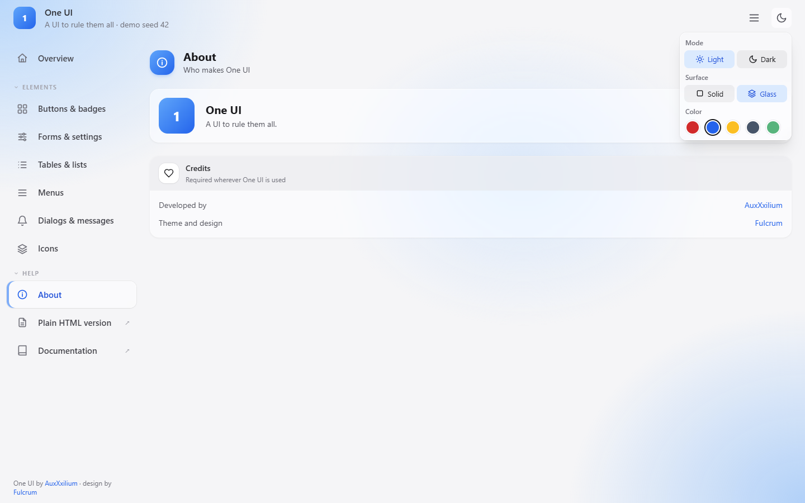

| Setting | Choices | What it does |
|---|---|---|
| **Mode** | Light · Dark | The whole interface turns dark or light. On a first visit it follows the computer's own setting. |
| **Surface** | Solid · Glass | **Glass** makes every box slightly see-through, with a soft blur behind it, over a stronger coloured background. |
| **Color** | Red · Blue · Amber · Graphite · Pastel Green | The highlight colour: buttons, the current page, links, progress bars. |

Status colours **never** change with the highlight: green always means good and red always means a problem.

**Another colour?** Add an entry to `ACCENT_PRESETS` in `src/theme.js`, with its shades from 50 to 950 like the five that are there. It shows up in the menu by itself.

**In code:** `useTheme()` does all of this for you. Pass it options if your app already stores the settings under other names, or uses a different starting colour:

```js
// Keep the names an app already stores its settings under, and start on amber:
const theme = useTheme({ accentKey: 'myapp_accent', darkKey: 'myapp_dark', defaultAccent: 'amber' });

// Start new visitors on glass:
const theme = useTheme({ defaultGlass: true });
```

**Only one glass box:** `<Card glass>` makes just that card see-through, even when the rest of the app is solid.

---

## App icons

Every Arc app's icon starts from the same **flat icon**: a slate rounded square with a white symbol and one red detail. One script turns it into one of three finished styles. The symbol itself is never redrawn: it is lifted out of the flat icon exactly, so every style keeps the artwork pixel for pixel.

Each picture shows the same four icons on white, on a dark background and on a colourful wallpaper.

| Style | Looks like |
|---|---|
| **Flat** (the source) | 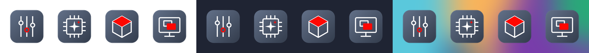 |
| **Frosted** | 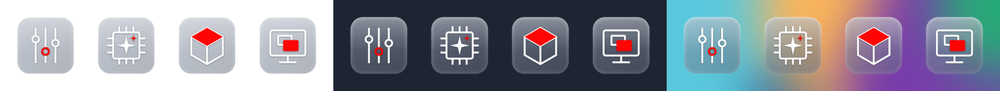 |
| **Frosted 3D** | 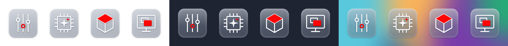 |
| **Glyph 3D** | 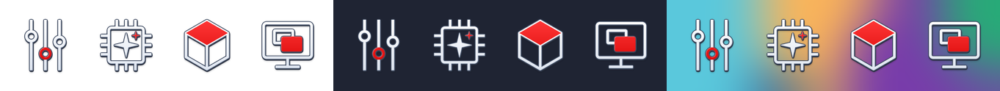 |

| Style | What it is | Use it when |
|---|---|---|
| `frosted` | The square as frosted glass: see-through, milky, with a fine grain, a glow along the edges and a bright rim. The wallpaper shows through. | The icon sits on a desktop or a dark menu. |
| `frosted-3d` | The same glass, with the symbol standing off it and the square showing its thickness, with a soft shadow under it. | As above, with more depth. |
| `glyph-3d` | No square: the symbol alone and larger, with a white face in a slate outline over a dark side and a small shadow. | The icon also appears on **white**: menus, window title bars, Package Center. Glass turns pale on white and the white symbol fades with it, so this is the style the Arc apps use. |

**Making one:**

```bash
python icons/app-icon.py --style glyph-3d my-app-flat.png -o my-app.png
python icons/app-icon.py --style frosted  my-app-flat.png -o my-app.png
```

- The script needs Python 3 with **Pillow** and **NumPy** (`pip install pillow numpy`).
- `--style` is `frosted`, `frosted-3d` or `glyph-3d` (the default).
- `--fill` sets how much of the icon the symbol fills in `glyph-3d`, as a share. The default is `0.72`.
- The source must be a **flat** icon in the template: 1280 × 1280 px, a 1024 px square with rounded corners, the slate gradient, a white symbol and red details. **Keep the flat file.** A finished icon can't be used as the source again.

---

## The elements

Each element below has a picture, what it is for, and the shortest code that uses it. Icons are given **by name**, e.g. `icon="refresh"`. The [Icons](#icons) section lists them all.

### AppShell

**The whole frame of an app:** the title bar at the top, the page list on the left and your page on the right, on the soft coloured background. Start here.

```jsx
<AppShell title="My App" subtitle="Plan your projects" logo="logo.png"
          theme={useTheme()} nav={NAV} active={page} onSelect={setPage}>
  …your page…
</AppShell>
```

| Option | Meaning |
|---|---|
| `title`, `subtitle`, `logo` | The app's name in the title bar. `logo` is a picture address, or anything you want to show. |
| `theme` | What `useTheme()` gives you. Adds the appearance menu. |
| `nav`, `active`, `onSelect` | The pages in the sidebar, which one is open, and what to do when one is clicked. |
| `actions` | Extra buttons in the title bar, next to the appearance menu. |
| `credits` | The One UI credit at the bottom of the sidebar. On by default. Only turn it off if you show `<Credits />` somewhere else. |

### Sidebar

**The page list.** `AppShell` already includes it; use it on its own only if you build your own frame.

Each page in the list is `{ id, label, icon }`. Add `section: 'Hardware'` to put it under a heading; headings fold away when clicked, and that is remembered. Add `href: 'https://…'` to make it a link that opens in a new tab (it gets a small ↗).

The current page is a white pill with a coloured bar on its left. The ☰ button shrinks the sidebar to icons only.

### PageHeader

**The top of every page:** a coloured icon tile, the page title, a line under it, and the page's own buttons on the right.

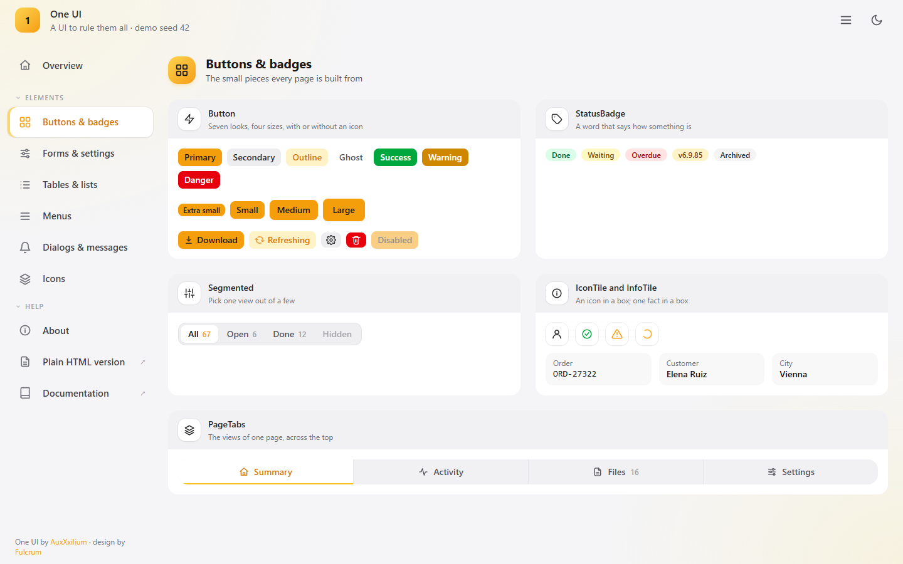

```jsx
<PageHeader icon="list" title="Tasks" subtitle="12 open, 3 due today"
            warning="Two tasks are overdue.">
  <Button icon="plus">New task</Button>
</PageHeader>
```

`warning` is optional and shows in amber with a ⚠ icon. Buttons placed inside stay grouped on the right and wrap on small screens.

### Card

**The white box everything sits in.** It can have a title bar with an icon, a short description and buttons on the right.

```jsx
<Card title="Tasks" subtitle="3 of 5 done" icon="check"
      actions={<Button size="xs" variant="secondary" icon="plus">Add</Button>}>
  …content…
</Card>
```

| Option | Meaning |
|---|---|
| `title`, `subtitle`, `icon` | The title bar. Leave them out for a plain box. |
| `actions` | Buttons on the right of the title bar. |
| `iconTone` | Colours the icon to show a state, e.g. `"text-red-500"` for failed. `iconSpin` makes it turn. |
| `glass` | Makes only this card see-through. |
| `overflow="visible"` | Lets a drop-down menu stick out of the card instead of being cut off. |

### TabbedCard

**A card with two or more views**, switched by clicking the title bar. The view you are not looking at still shows its short description, so "2 away" is visible without switching.

```jsx
<TabbedCard value={view} onChange={setView} tabs={[
  { id: 'details', title: 'Project details', subtitle: 'Project Apollo', icon: 'info' },
  { id: 'team',    title: 'Team',            subtitle: '2 away',         icon: 'user' },
]}>
  {view === 'details' ? <Details /> : <Team />}
</TabbedCard>
```

### InfoTile and TILE

**One fact in a small grey box:** a small label above a value. Use them for order numbers, names and dates.

```jsx
<InfoTile label="Order" value="ORD-20418" />
<InfoTile label="Customer" value="Mira Holt" mono={false} />
```

Values are shown in a typewriter font, which suits codes and numbers. Use `mono={false}` for normal words. `TILE` is the same grey box as a class, for your own content: `<div className={`${TILE} p-3`}>…</div>`.

### Button

**Seven looks and four sizes**, with or without an icon.

```jsx
<Button>Save</Button>
<Button variant="secondary">Cancel</Button>
<Button variant="danger" icon="trash">Delete</Button>
<Button variant="ghost" icon="gear" iconOnly>Settings</Button>
```

| `variant` | Use it for |
|---|---|
| `primary` *(default)* | The main action on a page or dialog. One per area. |
| `secondary` | Everything else: Cancel, Close, Back. |
| `outline` | An action in the highlight colour that is less loud than primary, e.g. Refresh. |
| `ghost` | Quiet actions in a row, e.g. the small buttons on a table line. |
| `success` · `warning` · `danger` | Actions with a clear outcome: Start, Force, Delete. |

| Option | Meaning |
|---|---|
| `size` | `xs`, `sm` *(default)*, `md`, `lg`. `sm` is right almost everywhere. |
| `icon` | An icon in front of the text. Add `spin` to make it turn while something is working. |
| `iconOnly` | Shows only the icon. The text becomes the tooltip and what screen readers say. |
| `disabled` | Greys the button out. |

### StatusBadge

**A small coloured word that says how something is.**

```jsx
<StatusBadge status="success" label="Done" />
<StatusBadge status="error" label="Overdue" title="Was due on 12 October" />
```

`status` is `success` (green), `warning` (yellow), `error` (red), `info` (highlight colour) or left out (grey). `title` adds hover text for details that don't fit in one word.

### Segmented

**Choose one view out of a few.** The chosen one is lifted out as a white pill, and a number can follow each choice.

```jsx
<Segmented value={filter} onChange={setFilter} items={[
  { id: 'all',   label: 'All',   count: 67 },
  { id: 'open',  label: 'Open',  count: 6 },
  { id: 'done',  label: 'Done',  disabled: true },
]} />
```

### PageTabs

**The views of one page, across the top.** Use these when one sidebar entry has several screens, e.g. Summary, Activity, Files. The open one is white with a coloured line under it.

```jsx
<PageTabs value={tab} onChange={setTab} items={[
  { id: 'summary',  label: 'Summary',  icon: 'main' },
  { id: 'activity', label: 'Activity', icon: 'activity' },
  { id: 'files',    label: 'Files',    icon: 'file', count: 12 },
]} />
```

> **Segmented, PageTabs or TabbedCard?** PageTabs switch the **whole page**. TabbedCard switches **one card**. Segmented filters or sorts **what is inside** a card.

### ToggleSwitch

**An on/off switch** for settings that take effect immediately, with no Save button.

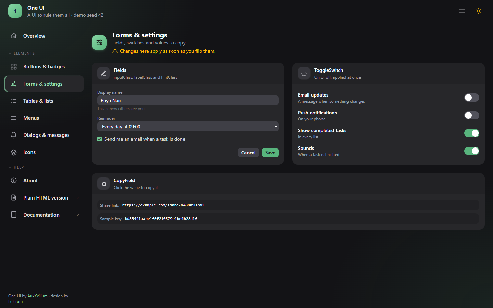

```jsx
<ToggleSwitch checked={enabled} onChange={setEnabled} label="Email updates" />
```

`label` is read out by screen readers when there is no visible text beside it.

### Form fields

Text fields, drop-downs and checkboxes use three ready-made class strings, so every form looks the same. Fields are exactly as tall as a button, so they line up on one row.

```jsx
import { inputClass, labelClass, hintClass } from 'one-ui';

<label className={labelClass}>Display name</label>
<input className={inputClass} value={name} onInput={…} />
<p className={hintClass}>This is how others see you.</p>
```

You can also write `class="field"` instead of `inputClass`; it looks the same. Checkboxes, radio buttons and sliders take the highlight colour automatically.

### CopyField

**A value people can click to copy,** e.g. a share link or a key. It shows "Copied" for a moment afterwards, and it also works on plain `http://` addresses where many copy buttons fail.

```jsx
<CopyField label="Share link:" value="https://example.com/share/4f9a2c" />
```

`copyText('…')` is the same copying on its own, for your own buttons.

### Modal

**A dialog over the page.** Escape, the ✕ or a click outside closes it.

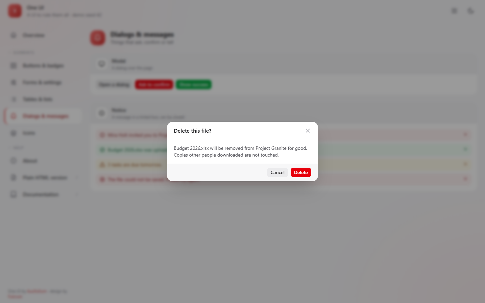

```jsx
// To show something:
<Modal isOpen={open} onClose={close} title="Project Apollo">…</Modal>

// To ask before doing something (gives Cancel + your button):
<Modal isOpen={open} onClose={close} title="Delete this file?" size="sm"
       message="It will be removed for good."
       onConfirm={remove} confirmLabel="Delete" confirmVariant="danger" />

// To say it worked (small, closes itself after 2 seconds):
<Modal isOpen={open} onClose={close} type="success" title="Done" message="Saved." />
```

| Option | Meaning |
|---|---|
| `size` | `sm`, `md` *(default)*, `lg`, `xl`. |
| `footer` | Your own buttons for the bottom bar, or `false` for no bottom bar. By default it shows a Close button. |
| `onConfirm`, `confirmLabel`, `confirmVariant` | Turns the bottom bar into Cancel + a confirm button. |

### Notice

**A message in a coloured box.** Optional close button.

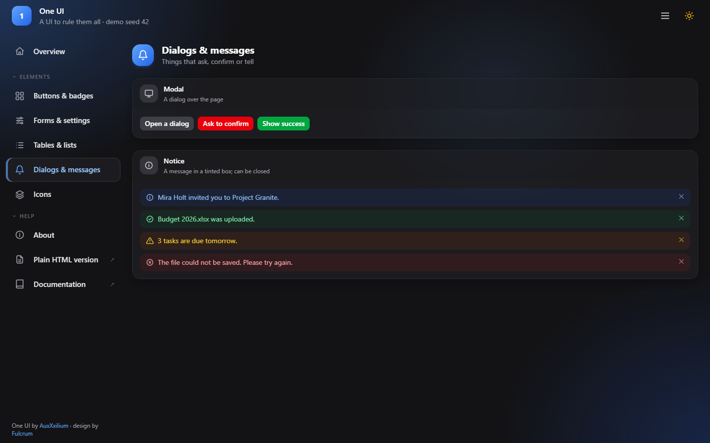

```jsx
<Notice tone="warning">Three tasks are due tomorrow.</Notice>
<Notice tone="error" title="Not saved" onClose={hide}>The file could not be saved.</Notice>
```

`tone` is `info` (highlight colour), `success`, `warning` or `error`. Each tone has its own icon, or you can choose one with `icon`.

### Loading, Empty and ProgressBar

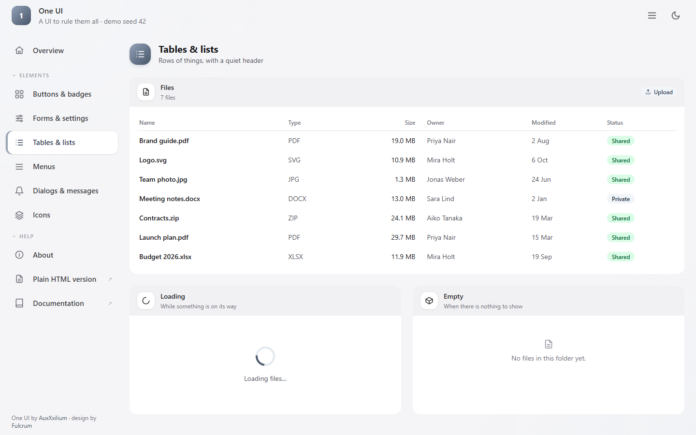

```jsx
<Loading message="Loading files…" />               // a spinner; size 6, 8, 10 or 16
<Empty icon="file">No files in this folder yet.</Empty>
<ProgressBar value={0.42} />                        // 0.42 means 42 %
<ProgressBar value={0.91} tone="bg-red-500" />      // a status colour instead of the highlight
```

Use these instead of writing your own, so waiting and "nothing here" look the same on every page.

### Tables

**Put `data-table` on any table** for the One UI look: a quiet grey header, roomy rows and a tint under the row the mouse is over. On a phone, a table that is too wide scrolls sideways inside its card.

```jsx
<table className="data-table w-full text-sm">
  <thead><tr><th>Name</th><th>Status</th></tr></thead>
  <tbody><tr><td>Brand guide.pdf</td><td><StatusBadge status="success" label="Shared" /></td></tr></tbody>
</table>
```

### Icons

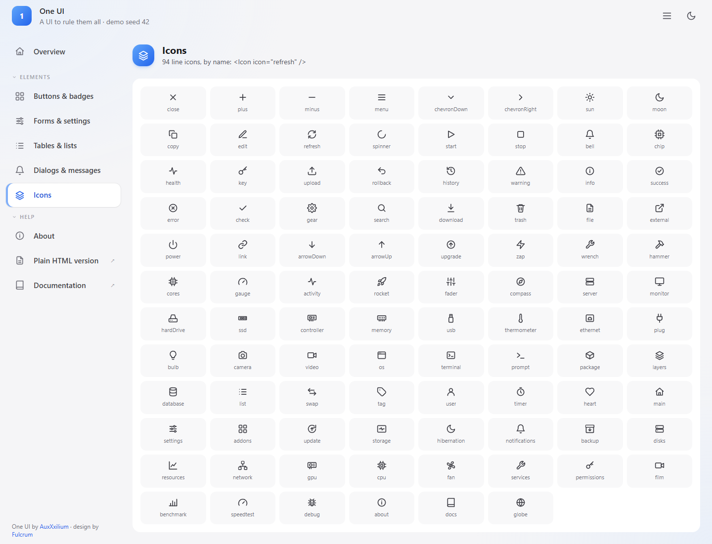

There are 94 line icons, all drawn the same way so they sit well together and take the colour of whatever they are in. Use them by name:

```jsx
<Icon icon="refresh" />                        // 16 px, in the text colour
<Icon icon="warning" size={20} className="text-amber-500" />
<IconTile icon="user" />                       // on a small white tile, as in card titles
<IconTile icon="success" tone="text-green-600" />
<IconLabel icon="download">Download</IconLabel>   // icon + text with the right gap
```

The names are shown in the picture above and on the demo's **Icons** page. Every component's `icon` option takes the same names.

### Credits

**The required credit, ready-made.**

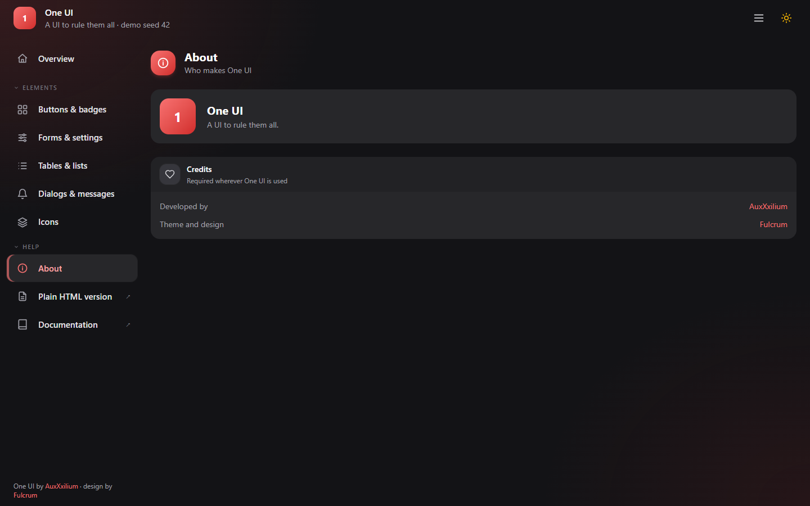

```jsx
<Credits />                       // the full block for an About page
<Credits compact />               // one short line, for a footer
<Credits extra={[{ label: 'Made for', name: 'Sample Shop', href: 'https://example.com' }]} />
```

`extra` adds your own lines above the One UI ones.

---

## Plain HTML (no build step)

For pages without Preact or Tailwind. Link the two files and write normal HTML:

```html
<link rel="stylesheet" href="one-ui-plain.css">
<script src="one-ui-plain.js"></script>
```

| Light | Dark, glass, amber |
|---|---|
| 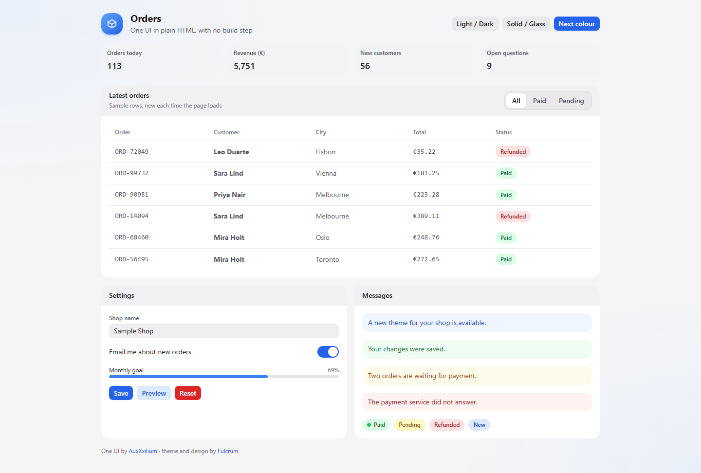 | 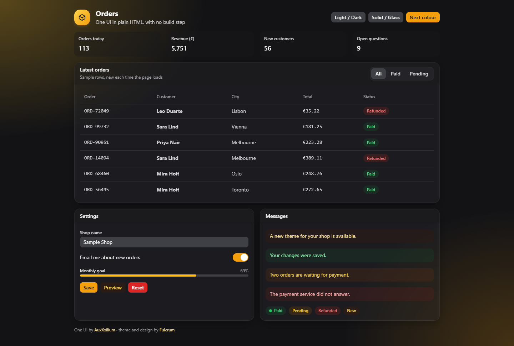 |

Headings, paragraphs, links, `code`, form fields and checkboxes are styled as soon as the file is linked. For everything else, add these classes:

| Class | What it is |
|---|---|
| `oui-page` | Centres the page at a comfortable width. |
| `oui-header` › `oui-header-title`, `oui-header-actions` | The page heading with its buttons on the right. Put an `oui-icon-tile` with an icon inside the title. |
| `oui-card` › `oui-card-header`, `oui-card-body` | A card with a title bar. Add `oui-glass` for a see-through card. |
| `oui-tile` › `oui-tile-label`, `oui-tile-value` | One fact in a grey box. |
| `oui-stat` › `oui-stat-label`, `oui-stat-value` | A big number in a grey box. |
| `oui-btn` + `oui-btn-primary` / `-outline` / `-success` / `-danger` | Buttons. A plain `oui-btn` is the grey one. |
| `oui-badge` + `oui-badge-success` / `-warning` / `-error` / `-info` | Status words. |
| `oui-dot` + `oui-dot-success` / `-warning` / `-error` | A small status dot. |
| `oui-notice` + `oui-notice-success` / `-warning` / `-error` | Message boxes. |
| `oui-segmented` | A row of `<button>`s; give the chosen one `aria-selected="true"`. |
| `oui-switch` | Turns a checkbox into an on/off switch. |
| `oui-progress` | A progress bar: `<div class="oui-progress"><span style="width:40%"></span></div>` |
| `oui-table` | A table with the One UI look. |
| `oui-stack` · `oui-grid` · `oui-row` | Spacing: cards stacked, cards in columns, items in a row. |
| `oui-muted` · `oui-small` · `oui-mono` | Grey text, small text, typewriter text. |
| `oui-credits` | The credit line. **Required**, see [Credits](#credits-required). |

The script applies the remembered mode, colour and surface before the page appears, so it never flashes white. It also lets the page change them:

```js
OneUI.setDark(true);
OneUI.setAccent('amber');   // red, blue, amber, graphite, green
OneUI.setGlass(true);
```

If the app next to it stores its settings under other names, tell the script:

```html
<script src="one-ui-plain.js" data-accent-key="myapp_accent" data-dark-key="myapp_dark"
        data-default-accent="amber"></script>
```

The full example is [demo/plain.html](demo/plain.html).

---

## What is in this folder

```
src/                  The preset (Preact + Tailwind)
  one-ui.css            colours, dark mode, glass, tables, scrollbars
  theme.js              the five colours and the light/dark/glass switches
  useTheme.js           all of the above for a Preact app, remembered
  styles.js             inputClass, labelClass, hintClass
  icons.jsx             the 94 icons, Icon, IconTile, IconLabel
  components/           AppShell, Sidebar, AppearanceMenu, PageHeader, PageTabs, Card,
                        TabbedCard, Button, StatusBadge, ToggleSwitch, Segmented, Modal,
                        CopyField, Feedback (Loading, Empty, Notice, ProgressBar), Credits
  index.js              everything, from one place: import { Card } from 'one-ui'
plain/                The plain version
  one-ui-plain.css      the stylesheet
  one-ui-plain.js       the theme script (built from entry.js, don't edit it)
icons/                App icons
  app-icon.py           a flat icon to frosted, frosted 3D or glyph 3D
demo/                 The live demo: index.html and plain.html, built demo.js and demo.css
  src/                  the demo's sources, with its sample data
docs/renders/         The pictures in this README
NOTICE                The credit requirement
```

---

## Changing the demo and the pictures

```bash
npm install
npm run build     # builds demo/demo.js and demo.css; open demo/index.html
npm run render    # builds, then takes new pictures for docs/renders (needs Chrome or Edge)
```

The demo's content is made up and different on every load. Add `?seed=7` to the address to get the same content every time; the pictures use seed 42. The address can also choose what is shown, e.g. `index.html?page=forms&dark=1&accent=green&glass=1`.

**The live demo** at https://auxxxilium.github.io/one-ui/demo/ is the `demo/` folder exactly as it is in the repository: GitHub Pages serves the `main` branch, with this README as the start page. So after changing anything in `src/`, `plain/` or `demo/src/`, run `npm run build` and commit the rebuilt `demo/demo.js`, `demo/demo.css` and `plain/one-ui-plain.js` with your change.

---

## License

GPL-3.0. The credit requirement in [NOTICE](NOTICE) applies to every use.

**One UI, developed by [AuxXxilium](https://auxxxilium.tech), theme and design by [Fulcrum](https://github.com/FulcrumCode).**
